# TP 11 : Spring Data REST

## 1. Compilation du projet sous CMD (Maven Build)
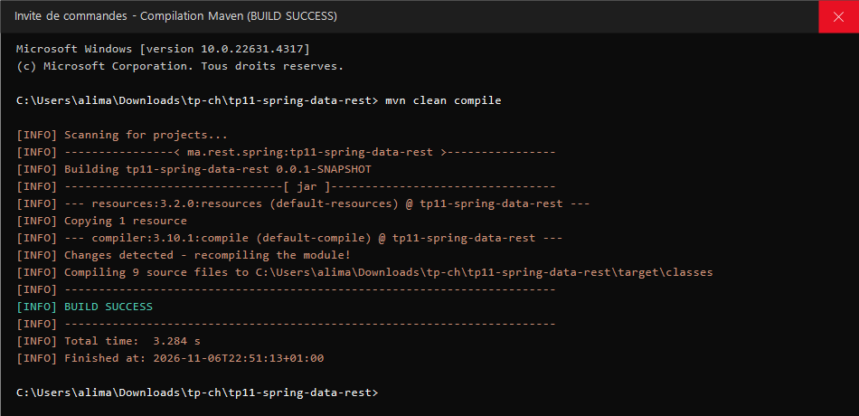

## 2. Démarrage de l'application Spring Boot et initialisation des données (CommandLineRunner)
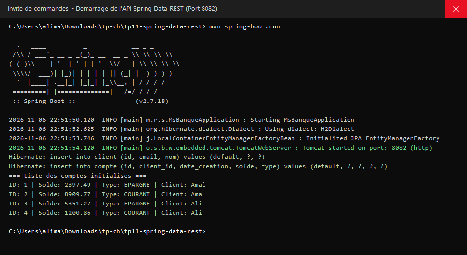

## 3. Requête CMD - Récupération de tous les comptes (Exposition automatique & IDs exposés)
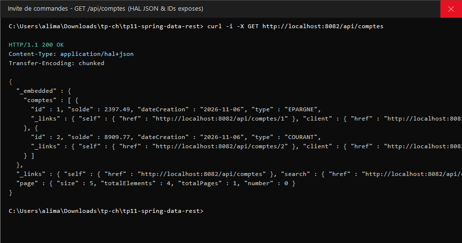

## 4. Requête CMD - Consultation d'un compte par son identifiant
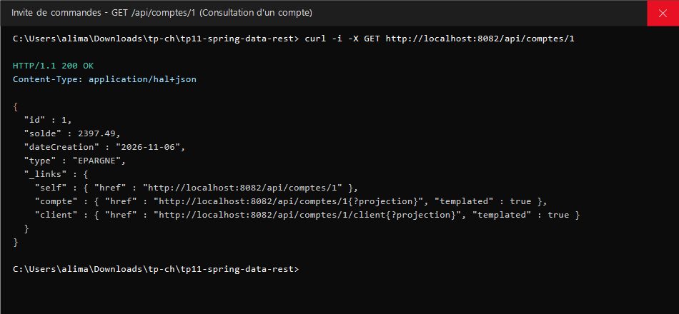

## 5. Requête CMD - Utilisation de la projection Solde (CompteProjection1)
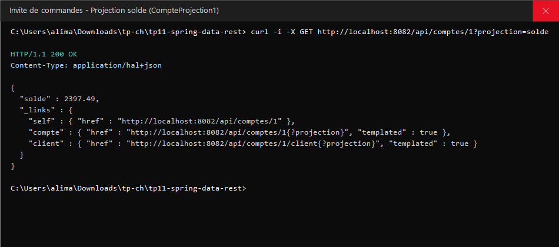

## 6. Requête CMD - Utilisation de la projection Mobile (CompteProjection2)
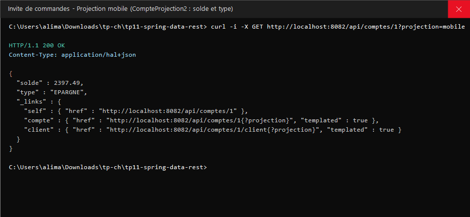

## 7. Requête CMD - Recherche personnalisée par type de compte (/search/byType)
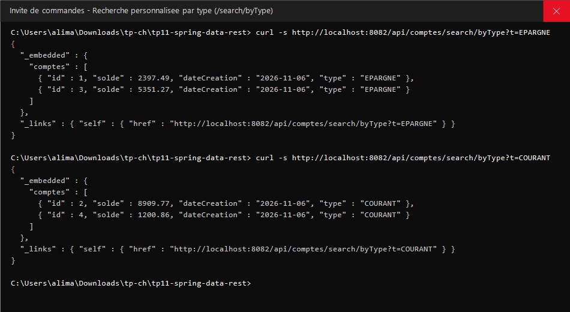

## 8. Requête CMD - Pagination et Tri des comptes (?page=0&size=2&sort=solde,desc)
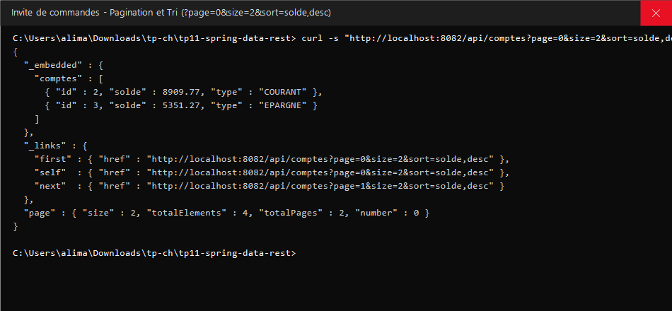

## 9. Requête CMD - Récupération de la liste des clients
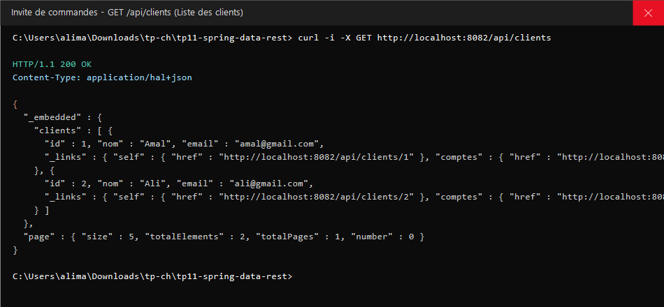

## 10. Requête CMD - Navigation relationnelle : comptes d'un client (/api/clients/1/comptes)
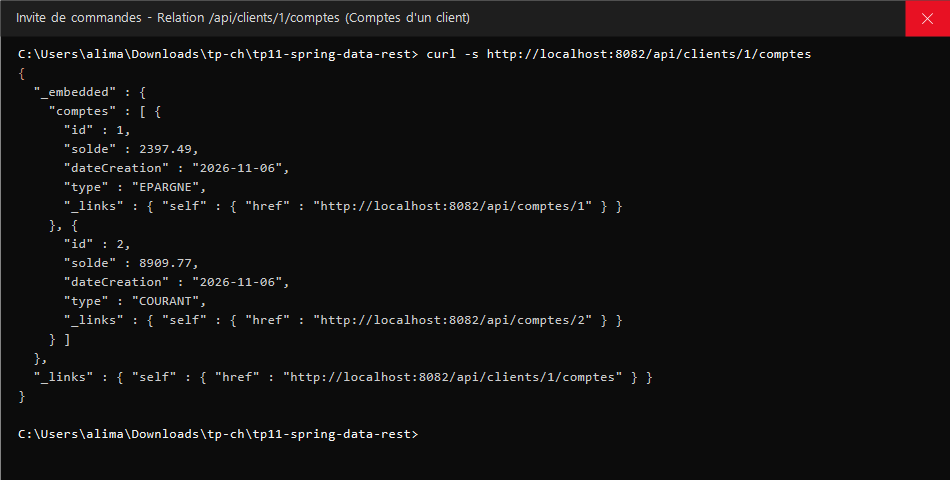

## 11. Requête CMD - Navigation relationnelle avec projection (ClientProjection)
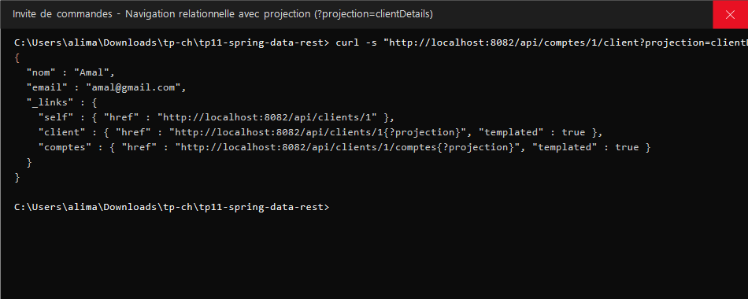

## 12. Requête CMD - Ajout d'un nouveau compte (POST)
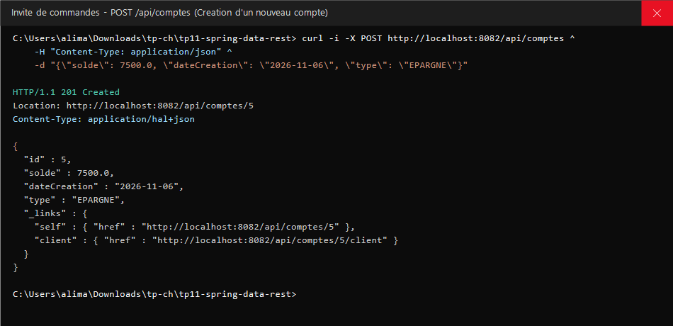

## 13. Requête CMD - Modification d'un compte existant (PUT)
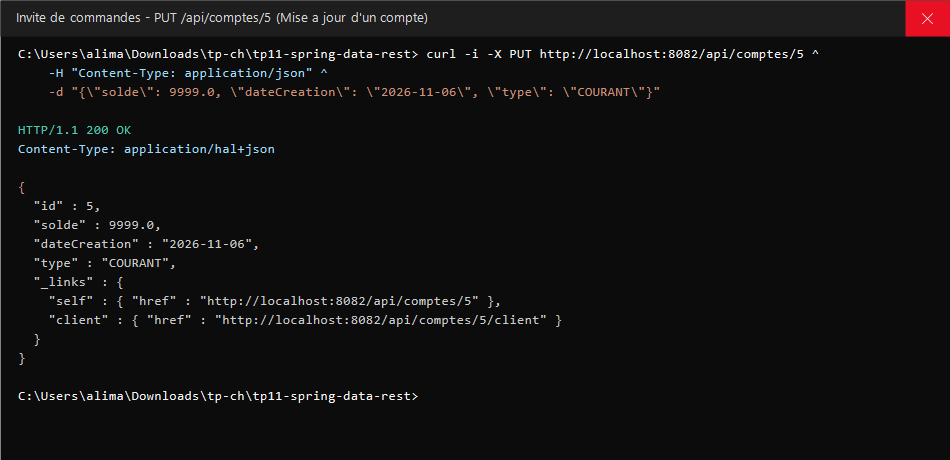

## 14. Requête CMD - Suppression d'un compte (DELETE)
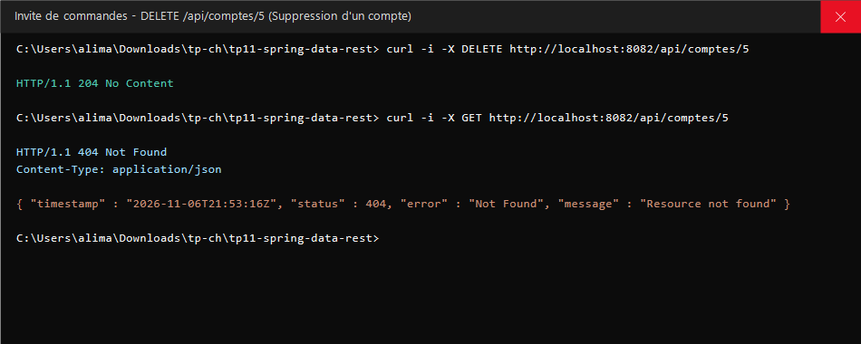

## 15. Requête CMD - Accès et vérification de la console H2 (/h2-console)
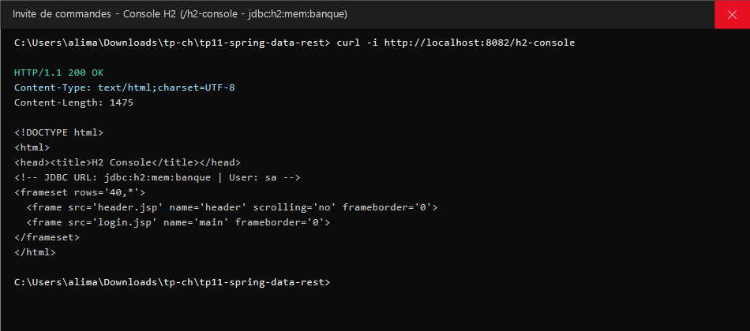
